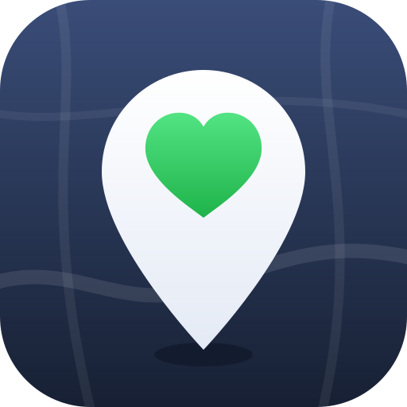

<p align="center"></p>

<h1 align="center">CareMap</h1>

<p align="center">Find affordable care near you, before you go.</p>

Type a plain-language message like:

> "07018, family of 4, $52k, uninsured, need gallbladder surgery"

and CareMap finds nearby hospitals, estimates what you'd actually owe under
your state's hospital charity-care law (17 states modeled so far, see
below), and shows it on a map colored by what you'd pay: green for free
care, amber for a reduced rate, gray for full price.

## Why

Hospital bills are often negotiable or forgivable under programs most
people never hear about. CareMap makes the eligibility math and the typical
billed charges visible up front, from public data, before a bill ever
arrives.

## How it works

- **Privacy first.** Household income and size never leave your browser.
  A regex pre-pass (`src/lib/intake.ts`, mirrored server-side in
  `caremap/intake.py`) extracts them locally, computes your charity-care
  tier on the spot, and only ever sends that tier (not the raw numbers)
  anywhere else.
- **Works with no AI call.** Eligibility, nearby facilities, and typical
  billed charges are all computed client-side in under a second
  (`src/hooks/useCareMap.ts`). An optional AI agent (Strands SDK, Python)
  can add a richer natural-language reply on top, but the map and the
  numbers never depend on it.
- **Every dollar figure is grounded.** The agent side
  (`caremap/guards.py`) enforces that any $ figure or tier percentage in an
  AI reply must trace back to an actual tool result, labeled a "typical
  billed charge" and never "your price," with an estimate disclaimer.

## Data

All public domain, real, and current as of the last `scripts/build_data.py`
run:

- Hospital names, addresses, ER/star rating: CMS Hospital General
  Information
- Typical billed charges and average Medicare payments per procedure (DRG):
  CMS Medicare Inpatient by Provider and Service (2024 data)
- Geocoding: US Census batch geocoder, with a zip-centroid fallback
- Zip code centroids: US Census ZCTA Gazetteer
- Urgent care centers: the CMS NPPES NPI Registry API, organizations whose
  primary specialty is urgent care (taxonomy 261QU0200X), one per practice
  address (~11,700 sites; listings are self-reported)
- Sliding-fee health centers: HRSA Health Center Service Delivery and
  Look-Alike Sites (11,200 permanent, public-facing medical clinic sites), priced by
  the federal FQHC sliding-fee rule (42 CFR 51c.303)
- State charity-care rules: each state's own statute or regulation (see
  the table below; every number lives in `policy/policy.json` with its
  citation)
- Federal poverty guidelines: HHS annual update

Hospital locations and typical billed charges cover all 50 states + DC:
about 4,500 acute care, Critical Access, and VA hospitals.

Searches also show the 3 nearest listed urgent care centers, as locations
only (no prices), and only suggest them for minor, non-emergency care --
never for a hospital procedure, and always alongside "call 911 or go to an
ER" for emergencies.

Every search also shows the nearest few federally funded sliding-fee
health centers (FQHCs and Look-Alikes). Their discounts follow a federal
rule, the same in every state: a full discount at or below 100% FPL (a
small flat fee may apply), each clinic's own sliding scale up to 200%, and
no one turned away for inability to pay. CareMap has no clinic prices, so
it never shows a dollar amount for a clinic.

## Modeled states

Every state below was checked against the current text of its own law,
not a summary. The deciding question is what the discount applies to: a
percentage of billed charges can be computed from CMS data, but a
discount tied to a Medicare or Medicaid rate, a hospital's cost-to-charge
ratio, or an insurance premium can't, so CareMap shows only the part it
can ground and says why.

| State | Law | What CareMap shows |
|---|---|---|
| NJ | NJ Charity Care (NJ Department of Health) | Full sliding scale, free up to 200% FPL |
| WA | RCW 70.170.060 | Full sliding scale (the legal floor; larger systems must do better) |
| OR | ORS 442.610-442.618 | Full sliding scale (minimums), nonprofit hospitals only |
| MD | Health-General 19-214.1 | Full sliding scale, free up to 200% FPL |
| IL | 210 ILCS 89 | Free tier (200% FPL, 125% at Critical Access Hospitals); above it, the 20%-of-income cap |
| NY | Public Health Law 2807-k(9-a) | Free tier (200% FPL) |
| RI | 216-RICR-40-10-23.14 | Free tier (200% FPL) |
| MA | 101 CMR 613.00 (Health Safety Net) | Free tier (150% FPL) |
| ME | 22 M.R.S. 1716-A | Free tier (200% FPL, residents only); up to 400% FPL, the 4%-of-income payment-plan cap |
| VT | 18 V.S.A. 9482 | Free tier (250% FPL, residents only); above it, the 40%-minimum discount (no dollar figure) and 20%-of-income cap |
| NC | NCDHHS Medical Debt Mitigation program (a Medicaid payment condition, not a statute) | Free tier (below 200% FPL, residents only, 97 participating hospitals); above it, the 5%-of-income payment-plan cap |
| OH | OAC 5160-2-17 (Hospital Care Assurance Program) | Free tier (100% FPL, residents not on Medicaid) |
| SC | S.C. Code 44-6-150 (Medically Indigent Assistance Program) | Free tier (100% FPL, inpatient only, county-approved) |
| NV | NRS 439B.260 | At most 70% of the billed charge for uninsured inpatients at any income, at 17 "major hospitals" (identified from CMS bed-count and ownership data) |
| CA | H&SC 127405 (Hospital Fair Pricing Act) | No tier: at or below 400% FPL, a cap at the greater of Medicare or Medi-Cal rates, shown with CMS's average Medicare payment as a reference |
| CT | Conn. Gen. Stat. 19a-673 | At most each hospital's cost of care (about 21%-48% of the billed charge, from state-published cost-to-charge ratios) for uninsured patients at or below 250% FPL denied Medicaid |
| CO | C.R.S. 25.5-3-503, 10 CCR 2505-10 8.928 | No tier: at or below 250% FPL, a state rate of at least the greater of Medicare or Medicaid, with the Medicare reference and the 4%-of-income payment-plan cap |

Checked and left unmodeled, because there's no statewide percentage CareMap
could compute from billed charges, or the rule depends on data CareMap
doesn't have (bed counts, county or opt-in programs): AK, AL, AR, AZ,
FL, GA, HI, IA, ID, IN, KS, KY, LA, MI, MN, MO, MS, MT, ND, NE, NH, NM, OK, PA, SD, TN, TX, UT, VA, WI, WV, WY. DC's and Delaware's new laws
aren't confirmed in force: an emergency act lifted DC's funding delay on
October 1, 2026, but the official DC Code still lists it as not
implemented, and Delaware's starts January 1, 2027.
Every unmodeled state shows "rules coming soon" plus federal (501(r)) guidance
instead of a guessed number.

In every state, nonprofit hospitals also fall under federal law (26 U.S.C.
501(r)): someone who qualifies for the hospital's own financial assistance
policy can't be charged more than its "amount generally billed." Many
hospitals base that on Medicare's rates, so wherever no state rule gives a
figure, CareMap shows Medicare's average payment for the procedure at that
hospital (CMS, 2024) next to the typical billed charge, as a reference, not
a price.

The pipeline is state-agnostic (`python scripts/build_data.py --states
XX`): adding a state's *location* data is a data pull, but adding its *tier
formula* means verifying that state's actual law first.

## Running it

Backend (Python, Strands agents + policy math):

```
python3 -m venv .venv && source .venv/bin/activate
pip install -r requirements.txt
pytest
```

Frontend (React + Vite + MapLibre):

```
npm install
npm run dev
npm test   # frontend logic, incl. a check that every tier matches policy.json
```

The map and eligibility answers work with no setup. To enable the optional
AI chat enhancement, set `VITE_AGENT_URL` to a deployed agent endpoint (see
`.env.example`); `GEMINI_API_KEY` is required on that backend.

## What's not in yet

- Charity-care tiers for the other 33 states + DC
- Above the free tier in IL, NY, RI, MA, ME, VT, NC, OH and SC, the real discount depends
  on data CareMap doesn't load yet (cost-to-charge ratios, Medicaid rates,
  insurance premiums) or is left to each hospital; CareMap discloses the
  gap rather than showing a guessed percentage
- Psychiatric, children's, long-term care, military and rural emergency
  hospitals, and US territories
- A national point layer (currently loaded as per-state GeoJSON; a
  `.pmtiles` tile layer is the next step for scale)
