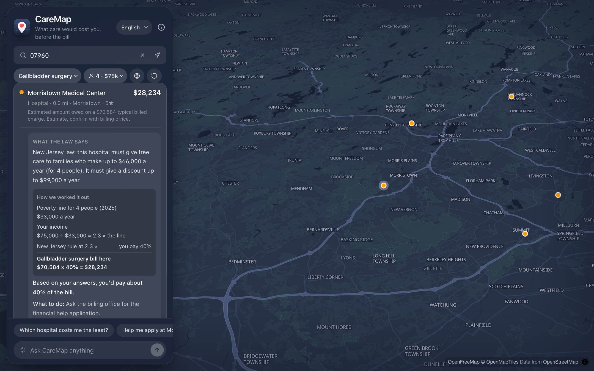
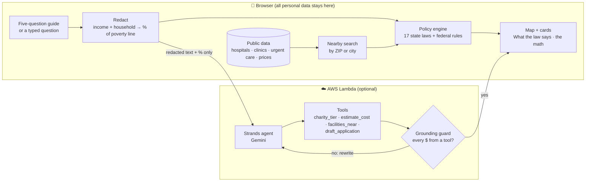
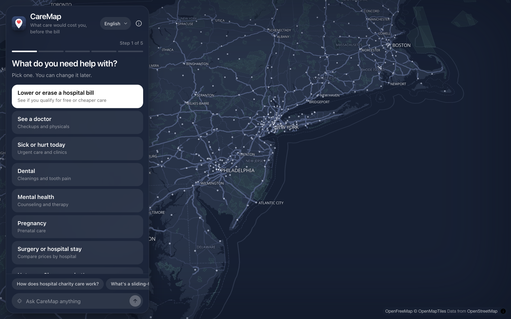
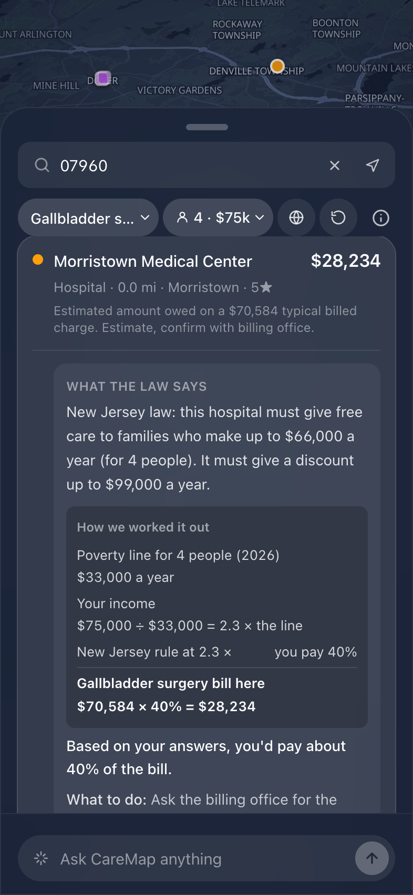
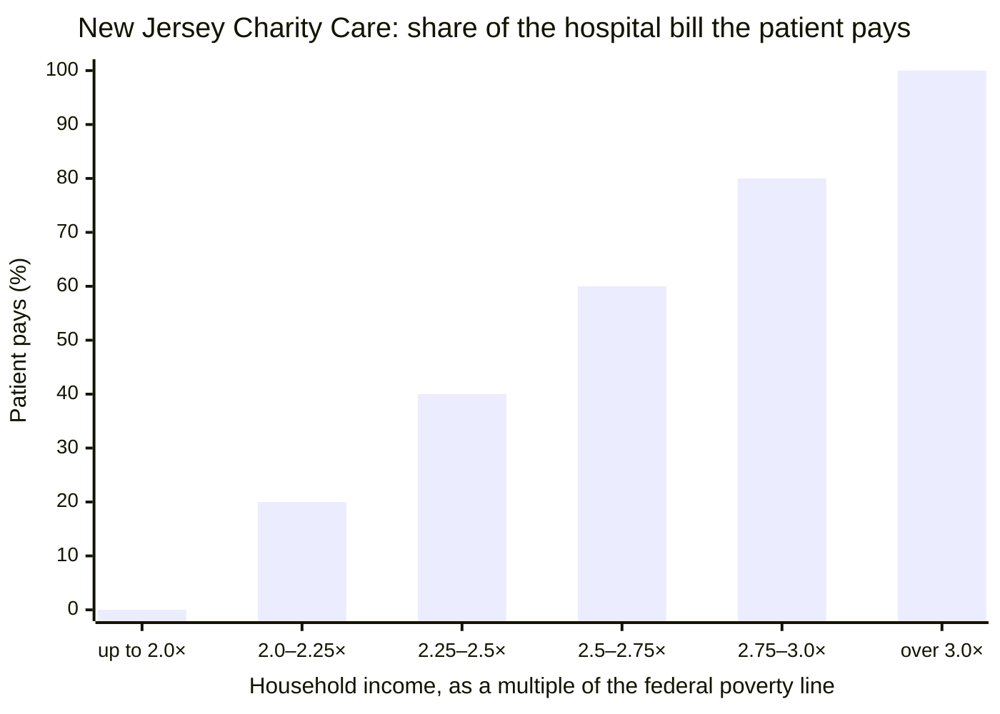
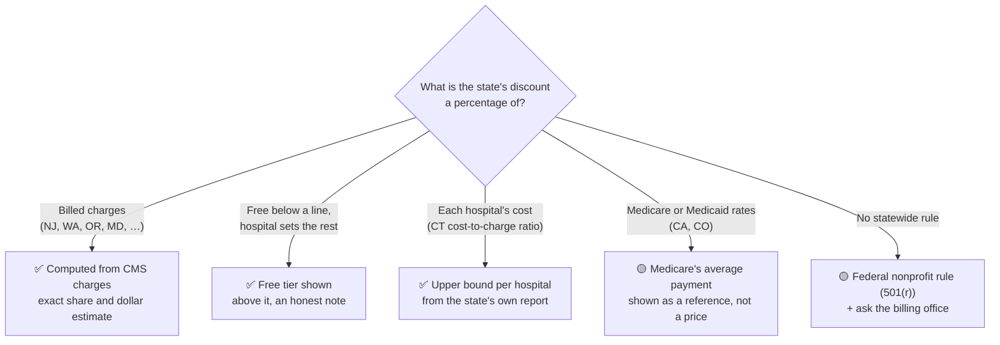
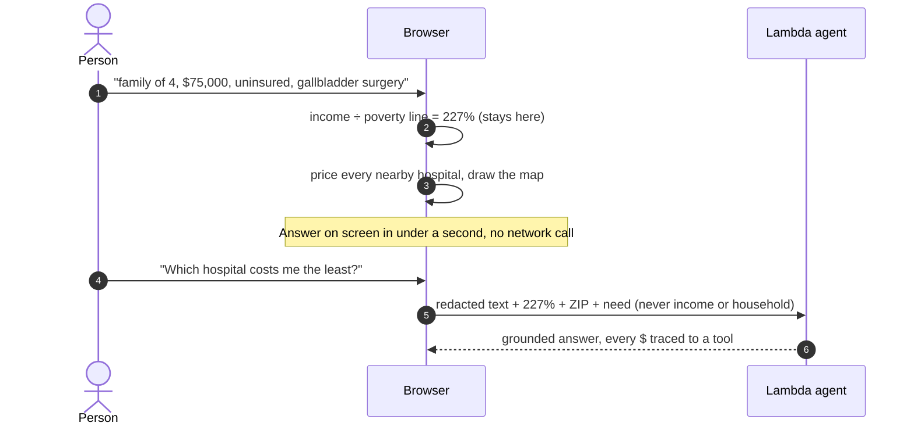
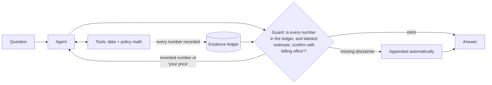
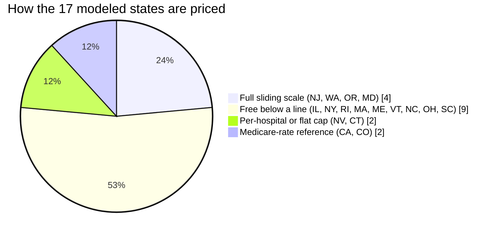
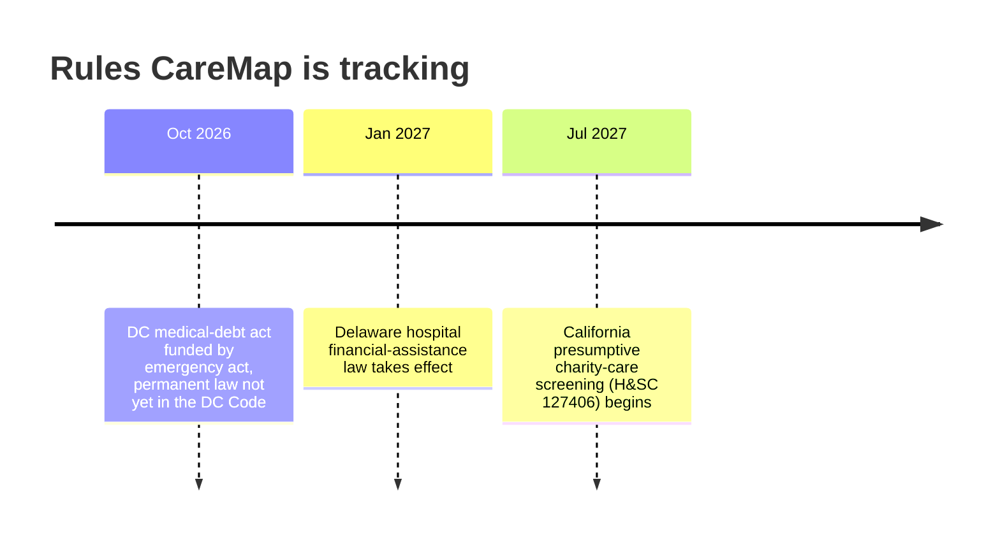

<p align="center"></p>

<h1 align="center">CareMap</h1>

<p align="center">
  <em>What care would cost you, before the bill.</em>
</p>

<p align="center">
  <strong>A map of every US hospital, sliding-fee clinic and urgent care center, priced for you under the law that applies there.</strong><br/>
  It reads each state's charity-care law, works out what you'd owe from public federal data, and shows the math.
</p>

<p align="center">
  
  
  
  
  
  
  
  
</p>

<p align="center">
  
  
  
  
</p>

<table>
  <tr>
    <td width="33%" valign="top"><h3>⚖️ The law, applied</h3>Each state's own charity-care statute, read from the source and encoded with its citation. No summaries, no guesses.</td>
    <td width="33%" valign="top"><h3>🧮 Shows the math</h3>Poverty line for your family, your income as a multiple of it, the rule at that multiple, the bill times your share.</td>
    <td width="33%" valign="top"><h3>🔒 Income stays home</h3>Household size and income never leave the browser. The AI sees a percentage, never a salary.</td>
  </tr>
  <tr>
    <td width="33%" valign="top"><h3>🗺️ Every kind of care</h3>Hospitals with real CMS prices, federally funded sliding-fee clinics, urgent care, and hospitals abroad for travelers.</td>
    <td width="33%" valign="top"><h3>🧭 Built for anyone</h3>A five-question guide, tap-to-choose income ranges, plain words at a 5th-grade level, English, Español, Français, 中文.</td>
    <td width="33%" valign="top"><h3>🛡️ Grounded AI</h3>Every dollar figure in an AI answer must come from a tool result, or a guard sends it back for a rewrite.</td>
  </tr>
</table>

<p align="center">
  <a href="#how-it-works"><b>How it works</b></a> ·
  <a href="#the-law-in-the-app">The law</a> ·
  <a href="#privacy-by-design">Privacy</a> ·
  <a href="#grounded-ai">Grounded AI</a> ·
  <a href="#coverage">Coverage</a> ·
  <a href="#whats-coming">What's coming</a> ·
  <a href="#run-it">Run it</a>
</p>

<p align="center">
  
</p>

### In one minute

Most hospital bills in America are negotiable, and many are forgivable: many states require hospitals to give free or discounted care to lower-income patients, and every nonprofit hospital must have a financial-assistance policy under federal law. Most people learn this only after a bill is in collections, if ever.

CareMap puts those rules on a map **before** care happens. Answer five quick questions (what you need, where, household size, an income range, insurance) and every nearby hospital is colored by what you'd likely pay: **green** free, **orange** reduced, **gray** no discount. Tap a hospital and it explains the law in plain words, in dollars for your family, and shows the arithmetic behind the number.

> [!TIP]
> **Try the demo case:** a family of 4 earning $75,000, uninsured, near Morristown, NJ, needing gallbladder surgery. Morristown Medical Center's typical billed charge is $70,584. At 2.3 times the poverty line, New Jersey's Charity Care law sets the patient's share at 40%, so CareMap shows **$28,234**, and how it got there.

### Start here

| You are | Look at |
|:---|:---|
| 🙋 **Someone who needs care** | Open the app, answer the five questions, tap any hospital for *What the law says* |
| 💼 **A recruiter or hiring manager** | [How it works](#how-it-works) · [privacy by design](#privacy-by-design) · [grounded AI](#grounded-ai) · [design decisions](#design-decisions) |
| 🛠️ **An engineer** | [Architecture](#how-it-works) · [run it](#run-it) · [project layout](#project-layout) · `npm test` and `pytest` |
| ⚖️ **A policy or legal reader** | [The law in the app](#the-law-in-the-app) · [state coverage](#coverage) · every rule and citation in [`policy/policy.json`](policy/policy.json) |

---

## How it works

Everything a person needs to decide runs **in the browser**, in under a second, with no AI call: finding nearby care, applying the state law, and pricing each hospital. The AI is an optional layer on top for questions in your own words.



<p align="center">
  
  
</p>

---

## The law in the app

There is no public dataset of charity-care rules, so each one was read from the current text of the state's own statute or regulation and encoded with its citation in [`policy/policy.json`](policy/policy.json). Both the Python agent and the TypeScript app read from it, and a test checks the two agree at every income from 0% to 700% of the poverty line.

New Jersey's law is a full sliding scale. This is what it means for a family:



For a family of 4 in 2026 the poverty line is **$33,000**, so free care reaches **$66,000** a year and some discount reaches **$99,000**. CareMap always says it in dollars like that, never as a bare percentage.

Not every law can be turned into a price. The deciding question is *what the discount is a percentage of*:



In **every** state, nonprofit hospitals fall under 26 U.S.C. §501(r): someone who qualifies for the hospital's own financial assistance can't be charged more than its "amount generally billed." Where no state rule gives a figure, CareMap shows what Medicare pays for the procedure at that hospital (CMS, 2024) next to the billed charge, as a reference.

<details>
<summary><b>All 17 modeled states, with citations</b></summary>

| State | Law | What CareMap shows |
|---|---|---|
| NJ | NJ Charity Care (NJ Department of Health) | Full sliding scale, free up to 200% FPL |
| WA | RCW 70.170.060 | Full sliding scale (the legal floor; larger systems must do better) |
| OR | ORS 442.610-442.618 | Full sliding scale (minimums), nonprofit hospitals only |
| MD | Health-General 19-214.1 | Full sliding scale, free up to 200% FPL |
| IL | 210 ILCS 89 | Free tier (200% FPL, 125% at Critical Access Hospitals); above it, the 20%-of-income cap |
| NY | Public Health Law 2807-k(9-a) | Free tier (200% FPL) |
| RI | 216-RICR-40-10-23.14 | Free tier (200% FPL) |
| MA | 101 CMR 613.00 (Health Safety Net) | Free tier (150% FPL) |
| ME | 22 M.R.S. 1716-A | Free tier (200% FPL, residents only); up to 400% FPL, the 4%-of-income payment-plan cap |
| VT | 18 V.S.A. 9482 | Free tier (250% FPL, residents only); above it, the 40%-minimum discount and 20%-of-income cap |
| NC | NCDHHS Medical Debt Mitigation program (a Medicaid payment condition) | Free tier (below 200% FPL, residents only, participating hospitals); above it, the 5%-of-income payment-plan cap |
| OH | OAC 5160-2-17 (Hospital Care Assurance Program) | Free tier (100% FPL, residents not on Medicaid) |
| SC | S.C. Code 44-6-150 (Medically Indigent Assistance Program) | Free tier (100% FPL, inpatient only, county-approved) |
| NV | NRS 439B.260 | At most 70% of the billed charge for uninsured inpatients at any income, at 17 "major hospitals" |
| CT | Conn. Gen. Stat. 19a-673 | At most each hospital's cost of care (about 21%-48% of the billed charge) for uninsured patients at or below 250% FPL denied Medicaid |
| CA | H&SC 127405 (Hospital Fair Pricing Act) | At or below 400% FPL, a cap at the greater of Medicare or Medi-Cal rates, with Medicare's average as a reference |
| CO | C.R.S. 25.5-3-503, 10 CCR 2505-10 8.928 | At or below 250% FPL, a state rate of at least the greater of Medicare or Medicaid, with the 4%-of-income payment-plan cap |

Checked and left unmodeled because there's no statewide rule CareMap could compute from billed charges: AK, AL, AR, AZ, FL, GA, HI, IA, ID, IN, KS, KY, LA, MI, MN, MO, MS, MT, ND, NE, NH, NM, OK, PA, SD, TN, TX, UT, VA, WI, WV, WY. Every one still gets real hospital locations and prices, the federal nonprofit rule, and a clear note.

</details>

---

## Privacy by design

Income is the most sensitive thing CareMap asks for, so it never leaves the device. A pre-pass in the browser ([`src/lib/intake.ts`](src/lib/intake.ts)) turns income and household size into one number, income as a percent of the poverty line, and removes the raw values from any text before it could be sent anywhere.



- **Saved on this device only**, so a refresh doesn't start over, with one-tap *Erase my answers*.
- **No accounts, no cookies, no ad trackers.** The FTC treats sharing health searches with advertisers as a breach; CareMap has nothing to share.
- **The AI backend** has a CORS allow-list, a per-IP rate limit, a message-length cap, and a fresh agent per request so one person's conversation can never reach another's.

---

## Grounded AI

The agent is a single [Strands Agents](https://strandsagents.com) agent in Python with Gemini Flash, deployed on AWS Lambda. All arithmetic and data access live in tools, not the model. Two hooks enforce the most important rule: **every dollar figure and percentage in a reply must come from a tool result.**



The model can explain, compare and draft an application letter, but it cannot invent a price. Tuning the guard to check only the text people read (not map coordinates) and to append a missing disclaimer instead of forcing a rewrite cut answer time roughly in half.

---

## Coverage



| Layer | Source | Count |
|:---|:---|---:|
| 🏥 Hospitals (acute, Critical Access, VA) | CMS Hospital General Information | 4,561 |
| 💵 Prices per procedure | CMS Medicare Inpatient by Provider and Service, 2024 | 69 procedures |
| 🩺 Sliding-fee health centers | HRSA Health Center Service Delivery Sites | 11,200 |
| 🚑 Urgent care | CMS NPPES NPI Registry (taxonomy 261QU0200X) | ~11,700 |
| 🌍 Hospitals abroad | OpenStreetMap (Nominatim, Overpass) | live |
| 📍 Places | US Census geocoder and ZCTA gazetteer | 33,000+ ZIPs |

Search a ZIP code, a city, a country, or **United States** for every hospital in the country, sorted by lowest cost to you once a procedure is picked.

---

## What's coming

Health-care price and debt law is changing quickly. These are the dates already on CareMap's list:



Next on the product side: human-reviewed translations of the law explanations, real hospital self-pay prices from federal price-transparency files, and a *check my bill* flow for people who already have one.

---

## Design decisions

<details>
<summary><b>Why the math runs in the browser, not the AI</b></summary>

Prices and eligibility are deterministic. Running them locally makes the answer instant, private, free to serve, and identical every time. The AI adds explanation and drafting on top; the map works even if the AI is down.
</details>

<details>
<summary><b>Why a guided form before chat</b></summary>

Most people don't know what to type into an AI. Research on consumer apps (Google Maps, Zocdoc, GoodRx) points the same way: a search box and tap targets first, AI as an optional layer. CareMap opens on five tap-to-answer questions and keeps chat one tap away.
</details>

<details>
<summary><b>Why income ranges instead of an exact salary</b></summary>

Typing a salary into a website is invasive. Tapping a range is faster and feels safer. Ranges are cut at 1 to 4 times the poverty line, in dollars for the household, and estimates use the top of the range, so CareMap never promises more help than someone may get. An exact amount is still one tap away.
</details>

<details>
<summary><b>Why "estimate" everywhere</b></summary>

CMS charges are averages from Medicare claims, not a quote. Every figure is labeled a typical billed charge, every estimate says to confirm with the billing office, and phrases like "your price" or "guaranteed" are blocked.
</details>

---

## Run it

```bash
# Frontend (React + Vite + MapLibre)
npm install
npm run dev        # http://localhost:5173
npm test           # 132 tests, incl. every tier against policy.json

# Backend (Python + Strands)
python3 -m venv .venv && source .venv/bin/activate
pip install -r requirements.txt
pytest             # 108 tests: policy math, tools, guards, handler
```

The map, prices and law explanations work with no setup. To enable the AI chat, deploy the agent (`scripts/deploy_lambda.sh`, with `GEMINI_API_KEY` set in the environment) and point `VITE_AGENT_URL` at it (see [`.env.example`](.env.example)).

<details>
<summary><b>Rebuilding the data</b></summary>

```bash
python scripts/build_data.py --states all   # hospitals + CMS prices → public/data/states, hospitals_index.json
python scripts/build_fqhc.py                # HRSA health center sites
python scripts/build_urgent_care.py         # NPPES urgent care sites
```

The app loads a small index of every hospital first, then each state's prices only when a search needs them.
</details>

## Project layout

```
caremap/            Python agent: tools, policy math, grounding guards, Lambda handler
policy/policy.json  Every state rule, with its citation and verification note
scripts/            Data builders (CMS, HRSA, NPPES, Census) and the Lambda deploy
src/lib/            Browser policy engine, pricing, the law explanations, intake redaction
src/components/     Guide, cards, menus, map, chat
src/i18n.ts         English, Spanish, French and Chinese interface text
tests/              Backend tests
```

<p align="center"><sub>CareMap shows estimates from public data. It isn't legal or medical advice; always confirm with the hospital's billing office.</sub></p>
